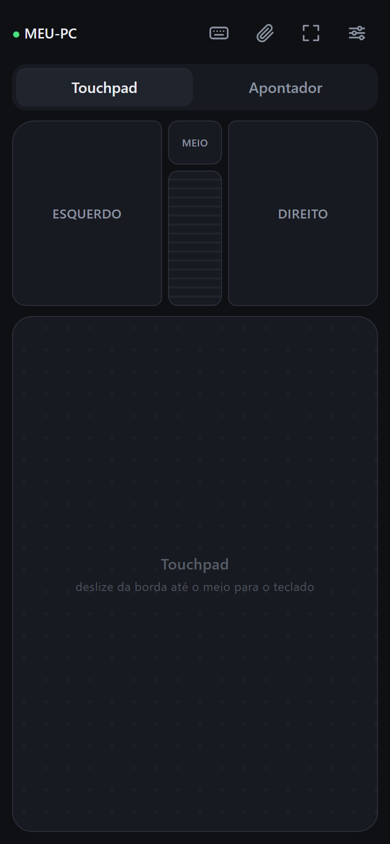
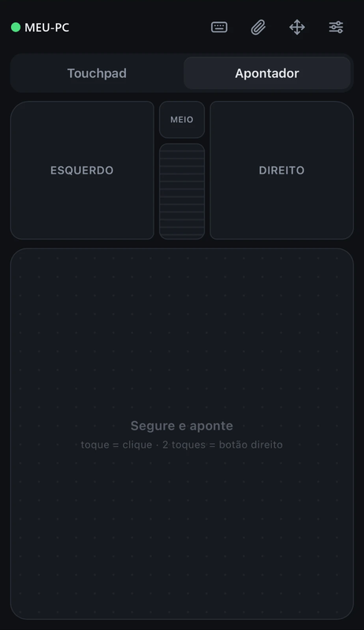
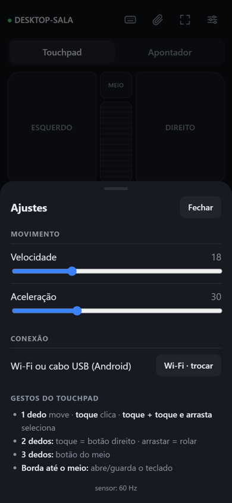
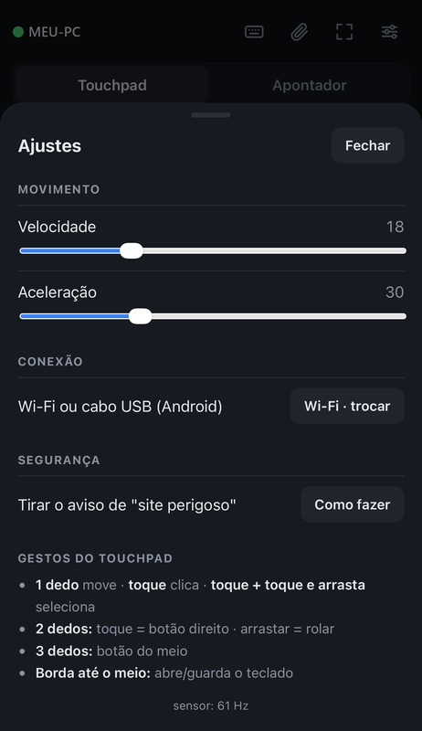
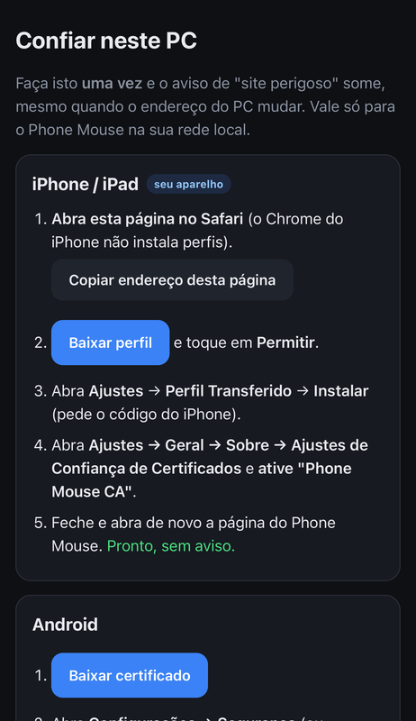
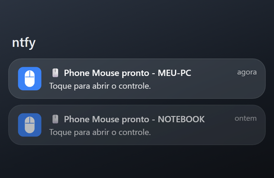

# Phone Mouse

[🇧🇷 Português](README.md) · **🇺🇸 English**

  

Turn your phone into a **mouse and keyboard for your Windows PC** using just the browser — **no app to
install on the phone**. Touchpad with gestures, gyroscope pointer, full keyboard (accents, emoji),
**file transfer both ways**, fullscreen, game-friendly admin mode and PIN-protected access.

<p align="center">
  
  
  
</p>

> The interface is currently in **Brazilian Portuguese**. Contributions with translations are welcome!

## Install (Windows)

**Easiest:** download the **[installer](https://github.com/Joao-VTech/phone-mouse/releases/latest)**
(`PhoneMouse-Setup-x.y.z.exe`), open it and click Next. No Python and no admin rights needed.
To uninstall: *Settings → Apps → Phone Mouse*.

> The installer is not digitally signed yet, so Windows may show "Windows protected your PC":
> click **More info → Run anyway**.
>
> **Checked on VirusTotal:** [1 of 70 antivirus engines](https://www.virustotal.com/gui/file/5c112408e8194d40c6a815f5ce82ac2c8073fdb5fd2a8d839404e5140c4a00da/detection)
> flagged the v1.2.1 installer (only Kingsoft, with a generic detection, a common false positive for packaged
> Python programs). **Microsoft Defender detects nothing**. All the code is in this repository, and each
> installer's SHA-256 is in the [release](https://github.com/Joao-VTech/phone-mouse/releases/latest) notes.

**From PowerShell (keyboard-only friendly):** **Win + R** → type `powershell` → **Enter**, then paste/type:

```powershell
irm https://raw.githubusercontent.com/Joao-VTech/phone-mouse/main/instalar-web.ps1 | iex
```

Answer the questions with **S** (yes) or **N** (no) — it works **with the keyboard only**, no mouse needed.
At the end a **QR code appears on screen**: point your phone camera at it and you're done — the QR code
already carries the access PIN.

<details>
<summary>Other ways to install</summary>

- **ZIP:** download the repository (**Code → Download ZIP**), extract it and double-click **`instalar.bat`**.
- **Manual:** `py -m pip install -r requirements.txt` and `py server.py` (or `py server.py --console` to see the log).

The installer: installs Python if missing (winget or python.org) and the dependencies; optionally `adb`
(USB cable, Android only); creates the **Phone Mouse** shortcut; optionally enables **admin mode**
(one Windows prompt: **Alt + S** on a Portuguese system, **Alt + Y** on English) and start with Windows.
</details>

## Everyday use

1. Open the **Phone Mouse** shortcut (or keep *Start with Windows* on).
2. On the phone, tap the **"Phone Mouse pronto - PC-NAME"** notification (or scan the QR code on the PC).
3. The first time: accept the certificate warning (it is self-signed), tap **Iniciar** (Start) and enter the **PIN** if asked.

## Modes

| Mode | How to use |
|---|---|
| 👆 **Touchpad** (default) | slide your finger on the screen, like a laptop touchpad |
| 🔦 **Pointer** | rotate your wrist and aim, like a laser pointer (gyroscope) |

### Touchpad gestures
- 1-finger drag: move the cursor
- tap: left click · tap + tap-and-drag: select/drag
- 2-finger tap: right click · 2-finger drag: scroll
- 3-finger tap: middle button
- swipe from the edge to the middle: open/close the keyboard
  (portrait: side edges · landscape: top/bottom edges)
- ⛶ fullscreen and ⟳ to rotate the screen (portrait → landscape → other side)

<p align="center">
  
  
</p>

### Keyboard
Types on the PC with accents, autocorrect and emoji. Bar with Esc, Tab, Ctrl, Alt, Shift, Win, arrows
and Del (tap the modifier, then the key, e.g. Ctrl → `c`). When the page itself is rotated, a built-in
keyboard that rotates with it is used.

## 📎 Files
- **Phone → PC:** on the page, **📎 Arquivos → Enviar para o PC** (photos, videos, any file).
  They go to **`Downloads\Phone Mouse`**; the PC shows a notice and opens the folder.
- **PC → phone:** right-click a file → **Send to → Phone Mouse (celular)**, or tray icon →
  *Enviar arquivo para o celular…*. The phone shows **"Baixar"** (Download) right away.
- The phone can only download what you chose to send from the PC — never any other file.

## 🔒 Access PIN
Each PC has a **6-digit PIN**. Without it nobody can control the PC, even on the same network.
- **Scanning the QR code on the PC screen pairs the phone** (the PIN is inside the QR); the phone remembers it.
- Or type the PIN: it is shown in the **tray icon**, on the QR code page and by `py server.py --pin`.
- The PIN is only used to **pair**: it is sent once, inside the encrypted connection (never in the URL),
  and the phone gets its own session. So it doesn't end up in browser history or logs.
- **Generate new PIN** (tray menu) disconnects every phone; they will ask for the PIN again.
- **PIN guessing protection:** after 5 wrong PINs the device is blocked (1 min, then 2, 4, 8... up to 1 h);
  the whole network can only get it wrong 10 times per minute; and after 30 wrong PINs the PC **changes
  the PIN by itself** and shows a notice (phones already paired keep working).
- The PC only accepts connections from the **local network** (and the USB cable); requests from the
  internet are refused.

### Remove the "unsafe site" warning
The PC has its **own certificate authority**, limited to **local network addresses only**. Trust it **once** on
each phone and the warning is gone for good, even when the PC's IP changes: in the app **settings** →
*Tirar o aviso de "site perigoso"* (or tray icon → *Tirar aviso…*, which shows a QR code). On iPhone, open the
page in **Safari** to install the profile.

**It is optional:** everything works without it, you just see the browser warning. How it works:
- The authority is created **on your PC** and can only sign local network addresses (`192.168.x.x`,
  `10.x.x.x`, etc.) and `localhost`. It is not valid for any internet site (bank, Google...), even if copied.
- Its key lives in `%LOCALAPPDATA%\Phone Mouse` (or the project folder in manual mode). Anyone with that file
  could impersonate devices on your local network (router, NAS) to phones that trust it. That's why it is
  **valid for 2 years** and replaced automatically near expiry (just trust it again).
- **Uninstalling** Phone Mouse deletes the key: the authority left on the phone can't sign anything anymore.
- **To remove it from the phone:** iPhone → *Settings → General → VPN & Device Management* → *Phone Mouse*
  profile → **Remove**. Android → *Settings → Security → Encryption & credentials → User credentials* →
  *Phone Mouse CA* → **Remove**.

<p align="center">
  
  
</p>

## Phone notification

<p align="center"></p>

On first run a page opens with QR codes to **download [ntfy](https://ntfy.sh)** (Google Play and App
Store) and, next to them, to **subscribe to your topic** (Android: QR code; iPhone: copy the topic →
in the app **+** → topic → **Subscribe**). To open it again: tray icon → *Configurar notificação no celular*.

To use the **same topic on several PCs**, copy `config.json` between them. To turn it off, set
`"notify"` to `false`. To change the displayed name, add `"pc_name": "Living room"`.

## Connection
- **Wi-Fi:** phone and PC on the same network.
- **USB cable (Android):** enable *USB debugging*, plug it in and tap **📶 Wi-Fi ⇄** on the page.
- **Network change (cable ↔ Wi-Fi):** the server notices it, resends the notification and, if no phone
  is connected, shows a QR code with the new address on screen.

## Troubleshooting

**The page stays blank/loading on the phone** — almost always the firewall, or the phone is on another
network. On the PC: **Win + R** → `powershell` → **Enter** and type:
```powershell
irm https://raw.githubusercontent.com/Joao-VTech/phone-mouse/main/diagnostico.ps1 | iex
```
It checks the server, network and firewall, offers to fix the firewall and shows the right address.

**Commands:** `py server.py --print-url` (QR code + PIN) · `--pin` · `--new-pin` · `--autostart on|off` ·
`--setup-notification` · `--install-admin` · `--send file` · `--console`.

## Notes
- **Windows limits:** the **sign-in screen**, **Ctrl+Alt+Del** and **UAC prompts** do not accept virtual
  mouse/keyboard input (Windows' own protection). Use the physical keyboard or Windows Hello there.
- **Admin mode:** needed for windows running as administrator and many games. Games with kernel-level
  anti-cheat deliberately block virtual mice, and some may **penalize or ban the account** for virtual
  input: use it at your own risk in online games. Admin mode is **off** by default; only enable it if needed.
- **iPhone:** the browser can't lock orientation or go truly fullscreen; the page rotates itself (⟳).
  To open without browser bars: Safari → Share → Add to Home Screen. USB cable doesn't work on iPhone.
- **Network:** use it on trusted networks. Traffic is encrypted (HTTPS), PIN-protected, and the PC only
  serves the local network. On public Wi-Fi (school, café), avoid admin mode.
- Notifications go through the public ntfy.sh server (only the PC name and local address, never the PIN).

## License
[MIT](LICENSE) © 2026 JV Tech — use, modify and share freely, keeping the copyright notice.
