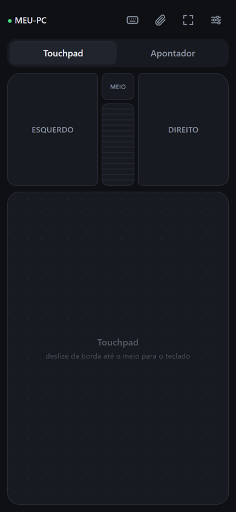
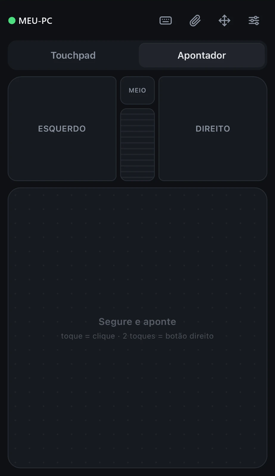
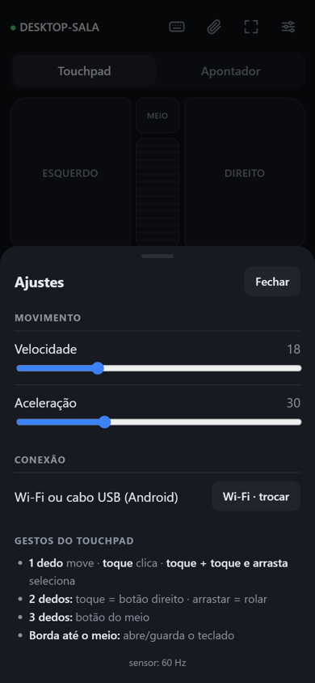
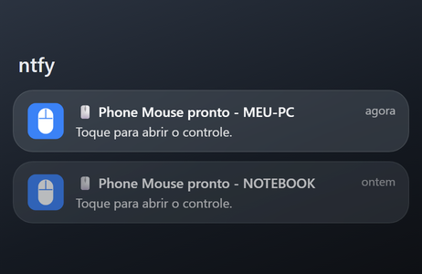

# Phone Mouse

**🇧🇷 Português** · [🇺🇸 English](README.en.md)

  

Use o celular como **mouse e teclado do PC** (Windows) pelo navegador — **sem instalar app no celular**.
Touchpad com gestos, apontador por giroscópio, teclado com acentos, **envio de arquivos** nos dois
sentidos, tela cheia, modo para jogos e acesso protegido por PIN.

<p align="center">
  
  
  
</p>

## Instalação (Windows)

**Mais fácil:** baixe o **[instalador](https://github.com/Joao-VTech/phone-mouse/releases/latest)**
(`PhoneMouse-Setup-x.y.z.exe`), abra e clique em Avançar. Não precisa instalar Python nem ser administrador.
Para desinstalar: *Configurações → Aplicativos → Phone Mouse*.

> Como o instalador ainda não tem assinatura digital, o Windows pode mostrar "O Windows protegeu o computador":
> clique em **Mais informações → Executar assim mesmo**.

**Pelo PowerShell (funciona só com teclado):** **Win + R** → digite `powershell` → **Enter**, e cole/digite:

```powershell
irm https://raw.githubusercontent.com/Joao-VTech/phone-mouse/main/instalar-web.ps1 | iex
```

Responda as perguntas com **S** ou **N** (funciona **só com teclado**, sem mouse). No fim aparece um
**QR code na tela**: aponte a câmera do celular e pronto — o QR já leva o PIN de acesso.

<details>
<summary>Outras formas de instalar</summary>

- **ZIP:** baixe o repositório (**Code → Download ZIP**), extraia e dê dois cliques em **`instalar.bat`**.
- **Manual:** `py -m pip install -r requirements.txt` e `py server.py` (ou `py server.py --console` para ver as mensagens).

O instalador: instala o Python se faltar (winget ou python.org) e as dependências; opcionalmente o `adb`
(cabo USB, só Android); cria o atalho **Phone Mouse**; opcionalmente ativa o **modo administrador**
(aviso do Windows uma vez: **Alt + S**) e o início junto com o Windows.
</details>

## Uso no dia a dia

1. Abra o atalho **Phone Mouse** (ou deixe *Iniciar com o Windows* ligado).
2. No celular, toque na notificação **"Phone Mouse pronto - NOME-DO-PC"** (ou escaneie o QR code do PC).
3. Na primeira vez: aceite o aviso de certificado (é autoassinado), toque em **Iniciar** e, se pedir, digite o **PIN**.

## Modos

| Modo | Como usa |
|---|---|
| 👆 **Touchpad** (padrão) | passa o dedo na tela, como no notebook |
| 🔦 **Apontador** | gira o pulso e aponta, como um laser (giroscópio) |

### Gestos do Touchpad
- 1 dedo arrastando: move o cursor
- toque: clique esquerdo · toque + toque e arrasta: selecionar/arrastar
- toque com 2 dedos: clique direito · 2 dedos arrastando: rolar
- toque com 3 dedos: botão do meio
- deslizar da borda até o meio: abre/guarda o teclado
  (na vertical: bordas laterais · na horizontal: bordas de cima/baixo)
- ⛶ tela cheia e ⟳ para virar a tela (vertical → horizontal → outro lado)

<p align="center">
  
  
</p>

### Teclado
Digita no PC com acentos, corretor e emoji. Barra com Esc, Tab, Ctrl, Alt, Shift, Win, setas e Del
(toque no modificador e depois na tecla, ex.: Ctrl → `c`). Com a tela girada pela página, usa um
teclado próprio que gira junto.

## 📎 Arquivos
- **Celular → PC:** na página, **📎 Arquivos → Enviar para o PC** (fotos, vídeos, qualquer arquivo).
  Vão para **`Downloads\Phone Mouse`**; o PC avisa e abre a pasta.
- **PC → celular:** botão direito no arquivo → **Enviar para → Phone Mouse (celular)**, ou ícone da
  bandeja → *Enviar arquivo para o celular…*. O celular mostra **"Baixar"** na hora.
- O celular só baixa o que você escolheu enviar no PC — nunca outros arquivos.

## 🔒 PIN de acesso
Cada PC tem um **PIN de 6 dígitos**. Sem ele ninguém controla o PC, mesmo estando na mesma rede.
- **Escanear o QR code da tela do PC já pareia** (o PIN vai dentro do QR); o celular memoriza.
- Ou digite o PIN: ele aparece no **ícone da bandeja**, na página do QR code e em `py server.py --pin`.
- **Gerar novo PIN** (menu da bandeja) desconecta todos os celulares, que pedem o PIN de novo.
- Após 5 PINs errados, o aparelho fica bloqueado por 1 minuto.

## Notificação no celular

<p align="center"></p>

Na primeira execução abre uma página com QR codes para **baixar o [ntfy](https://ntfy.sh)** (Google Play e
App Store) e, ao lado, para **assinar o tópico** (Android: QR code; iPhone: tópico para copiar → no app
**+** → tópico → **Subscribe**). Para abrir de novo: ícone da bandeja → *Configurar notificação no celular*.

Para usar o **mesmo tópico em vários PCs**, copie o `config.json` entre eles. Para desligar, mude
`"notify"` para `false`. Para trocar o nome mostrado, adicione `"pc_name": "Sala"`.

## Ícone da bandeja
Endereço e PIN · Enviar link para o celular · Enviar arquivo para o celular · Abrir arquivos recebidos ·
Mostrar QR do endereço · Gerar novo PIN ·
Configurar notificação no celular · Ativar modo administrador · Iniciar com o Windows · Sair.

## Conexão
- **Wi-Fi:** celular e PC na mesma rede.
- **Cabo USB (Android):** ative a *Depuração USB*, conecte e toque em **📶 Wi-Fi ⇄** na página.
- **Troca de rede (cabo ↔ Wi-Fi):** o servidor percebe sozinho, reenvia a notificação e, se nenhum
  celular estiver conectado, mostra na tela um QR code com o endereço novo.

## Problemas?

**Página fica branca carregando no celular** — quase sempre é o firewall ou o celular em outra rede.
No PC: **Win + R** → `powershell` → **Enter** e digite:
```powershell
irm https://raw.githubusercontent.com/Joao-VTech/phone-mouse/main/diagnostico.ps1 | iex
```
Ele verifica servidor, rede e firewall, oferece corrigir o firewall e mostra o endereço certo.

**Comandos:** `py server.py --print-url` (QR code + PIN) · `--pin` · `--new-pin` · `--autostart on|off` ·
`--setup-notification` · `--install-admin` · `--send arquivo` · `--console`.

## Observações
- **Limites do Windows:** a **tela de login**, o **Ctrl+Alt+Del** e os **avisos do UAC** não aceitam
  mouse/teclado virtuais (proteção do próprio Windows). Neles use o teclado físico ou Windows Hello.
- **Modo administrador:** necessário para janelas abertas como administrador e muitos jogos.
  Jogos com anti-cheat em nível de kernel bloqueiam mouses virtuais de propósito.
- **iPhone:** o navegador não permite travar a orientação nem tela cheia real; a página gira a si
  mesma (⟳). Para abrir sem barras: Safari → Compartilhar → Adicionar à Tela de Início. Cabo USB não
  funciona no iPhone.
- **Rede:** use em redes de confiança. O tráfego é criptografado (HTTPS) e protegido por PIN.
- A notificação passa pelo servidor público ntfy.sh (envia só o nome do PC e o endereço local, nunca o PIN).

## Licença
[MIT](LICENSE) © 2026 JV Tech — use, modifique e distribua à vontade, mantendo o aviso de copyright.
